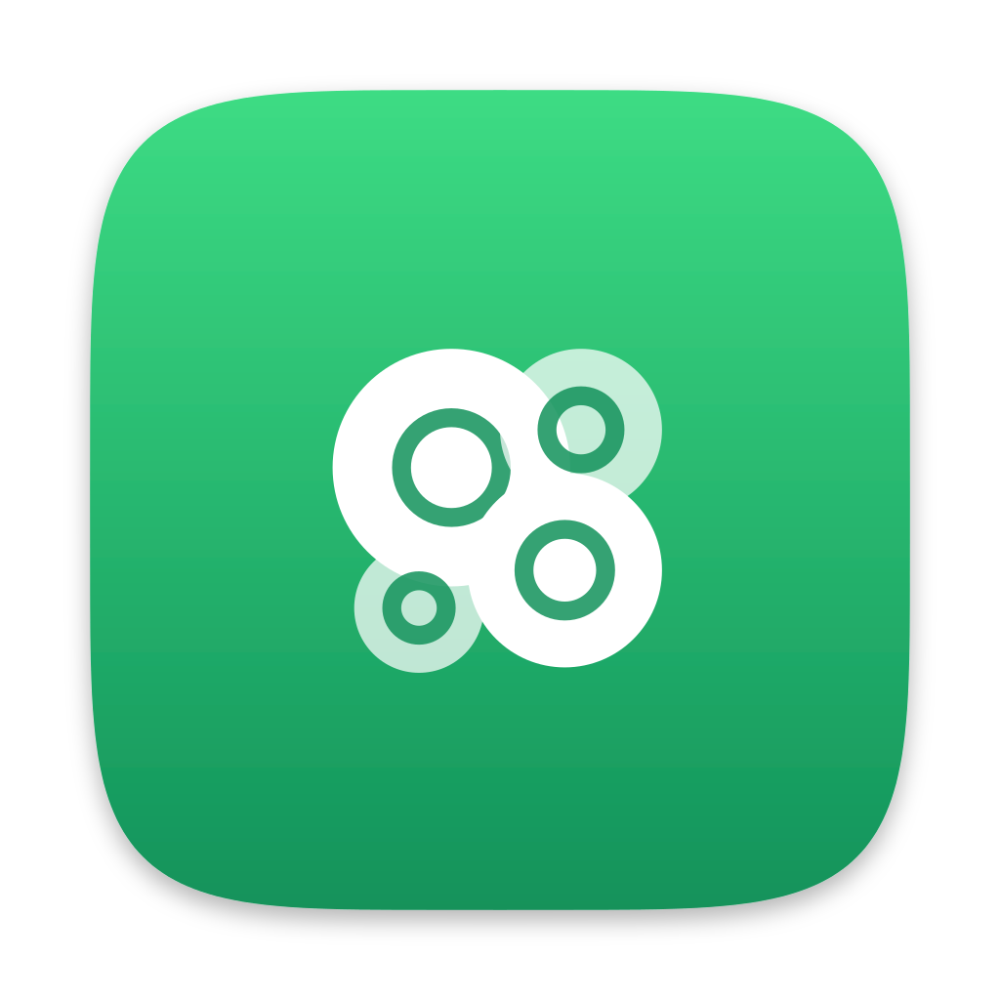

# lichen

A project for easily keeping dev environments in sync across your Macs
and Linux machines.

It syncs things, one module per kind of thing:

- **files**: dotfiles, slash commands, `CLAUDE.md`, app configs, anything
  under your home directory, written wherever each device needs it.
- **skills**: agent skills installed from public repos, kept up to date
  by polling.
- **mcp**: MCP servers, installed into Claude Code and Codex.

lichen is a pun on 'liken' and just how lichen behaves in general.

## Setup

Each device needs:

- git access that can clone the sync repo (SSH key or credentials, since
  the repo should be private)
- [crosstalk](https://github.com/dittofleet/crosstalk), installed and
  joined to your hub

lichen names each device the way crosstalk does, and nudges your other
devices through it after each push, so they pull within seconds. Pushes
made outside lichen arrive on an hourly pass.

Create an empty private repo once (the sync repo, e.g. `you/lichen-sync`),
then on every device:

```sh
curl -fsSL https://raw.githubusercontent.com/dittofleet/.github/main/install.sh | sh -s lichen
```

It asks for the sync repo's URL (or takes it from `LICHEN_REPO`), clones
it to `~/lichen`, and starts the daemon: a launchd agent on macOS, a
systemd user service on Linux. `lichen setup <git url>` does the same
later, if you skip the question.

## The sync folder

`~/lichen` holds everything lichen syncs, as plain files:

```
~/lichen/
  lichen.toml   device groups and settings
  files.toml    where each file goes
  skills.toml
  mcp.toml
  files/        the files themselves
```

The configs have one entry per output, repo or server:

```toml
# files.toml
["~/.zshrc"]
source = "shell/zshrc"
include = ["mac"]

["~/.codex/AGENTS.md"]
source = "agents/CLAUDE.md"
```

Edit anything in it and lichen commits and pushes it. You never run git
there yourself, but its history is all there.

## Which devices get what

Everything syncs to every device unless scoped. A scope is a list of
devices and groups, either included or excluded:

```sh
lichen files add ~/.zshrc shell/zshrc --include mac,lychee
lichen files add ~/.vimrc vim/vimrc --exclude servers
lichen files include ~/.zshrc mac   # change it later
lichen files exclude ~/.zshrc       # every device again
```

Skills and MCP servers work the same way, and [inserts](#inserts) use
`if` and `unless`. A device that falls out of scope keeps its files as
plain files and uninstalls its skills and servers.

`lichen devices` lists device names (crosstalk's) and their groups. `mac`
and `linux` are built-in groups. Custom groups are stored in `~/lichen/lichen.toml`:

```sh
lichen groups add servers hetzner-1 hetzner-2
lichen groups remove servers hetzner-2   # no devices: deletes the group
lichen groups                            # list groups
```

## Files

```sh
lichen files add ~/.zshrc shell/zshrc
```

The path becomes the source `shell/zshrc` in `~/lichen/files`, with an
output where it came from. Every device writes the outputs meant for it,
and editing either side syncs: the output (`~/.zshrc`) or the source
(`~/lichen/files/shell/zshrc`). A directory syncs as a whole, including
files added to it later.

`lichen files` shows every source and where it goes, and `lichen files
preview <source|path> [<device>]` prints a file as a device writes it,
with its [inserts](#inserts) settled for that device.

### Several outputs

One source can have several outputs, each with its own
[scope](#which-devices-get-what):

```sh
lichen files add ~/.codex/AGENTS.md --to agents/CLAUDE.md
lichen files add ~/.config/agents.md --to agents/CLAUDE.md --include linux
```

Edit any of them and the others follow. `lichen files include` and
`exclude` take a path for one output, or a source name for all of them.

When a device joins with its own copy of a file that is already synced,
the synced version replaces it. A file only you can read (`~/.netrc`,
say) is written that way everywhere.

### Inserts

A source can take in the lines of others, for one file put together
differently on each device. Write the pieces as files of their own in
`~/lichen/files`, and insert them with lines starting with `§`:

```
export EDITOR=vim
§ shell/aliases
§ shell/mac if mac
§ shell/work if lychee, servers
§ shell/gui unless servers
```

`~/.zshrc` gets `shell/aliases` everywhere, `shell/mac` on Macs,
`shell/work` on lychee and the servers, and `shell/gui` everywhere but
the servers. A piece can insert others, and needs no output of its own.
A line meant to start with `§` starts with `§§` in the source.

Where an insert is skipped, a blank line beside it goes too if it would
otherwise be doubled, or start or end the file.

Outputs show none of this, and editing them still syncs: lichen knows
which source each line came from, and an edited line goes back there.
New lines go to the source of the lines around them. Where an insert
begins or ends, they could belong to either, so lichen asks: it leaves
the file as it is on that device (a notification and `lichen status` say
so) until `lichen resolve` says which.

### Deleting and stopping

Deleting a synced file deletes it on every device, unless another device
edits it at the same time: then the edit wins, and the file comes back
everywhere. A file deleted by mistake comes back from the sync folder's
history, on all devices at once:

```sh
lichen files recover ~/.zshrc
```

`lichen files remove ~/.zshrc` stops syncing instead: every device keeps
its copy as a plain file. So does moving an output elsewhere, or taking a
device out of its scope.

### Edits on two devices at once

They merge, as long as they touch different lines. Edits to the same
lines are a conflict: lichen leaves the file as it is on that device and
says so (a notification, `lichen status`, the log) until you pick one.
`lichen resolve` walks through whatever waits, or settles one file:

```sh
lichen resolve ~/.zshrc --keep here      # or --keep synced
lichen resolve ~/.zshrc --into shell/mac   # where its new lines go
```

### Backups

Off by default. When a synced version replaces a device's own copy, or a
file deleted elsewhere is deleted here, the old one is gone. A directory
in the way is the exception: it may hold files that were never synced, so
it is always moved to `~/lichen-backups/`. To keep replaced and deleted
files there as well, set `backups` in `~/lichen/lichen.toml` (it syncs, so
this turns backups on for every device):

```toml
backups = true
```

## Skills

The skills module installs agent skills (`SKILL.md` directories, the
format the [Vercel skills CLI](https://github.com/vercel-labs/skills)
uses) from public repos:

```sh
lichen skills add vercel-labs/agent-skills --skill frontend-design
lichen skills add owner/single-skill-repo
```

The canonical copy lands in `~/.agents/skills/<name>` with a relative
symlink from `~/.claude/skills/<name>`, the same layout `npx skills`
creates, so Claude Code picks the skill up globally and both tools
coexist: lichen never touches a skill it didn't install. Other harnesses
get links too by listing their skill directories in the skills config:

```toml
harnesses = ["~/.claude/skills", "~/.codex/skills"]
```

A skill can limit itself to some harnesses with a comma-separated
`lichen-harnesses` under `metadata` in its `SKILL.md` frontmatter. A
harness is named after the directory holding its skills dir, so
`~/.claude/skills` is `claude` and `~/.codex/skills` is `codex`:

```yaml
---
name: my-skill
description: ...
metadata:
  lichen-harnesses: claude, codex
---
```

Some harnesses (Codex among them) read `~/.agents/skills` directly, so a
limited skill's canonical copy lives in `~/.local/share/lichen/skills`
instead, reachable only through the listed harnesses' links. List
`agents` to keep it in `~/.agents/skills`.

The list of skill repos lives in `~/lichen/skills.toml`, so adding a skill
on one device installs it everywhere, and removing one uninstalls it
everywhere. The
daemon polls each repo about hourly, and a repo moving only reinstalls
the skills whose content actually changed. `lichen skills update` checks
immediately.

A repo's skills can be [scoped](#which-devices-get-what):

```sh
lichen skills add owner/mac-skills --include mac
lichen skills exclude owner/mac-skills servers   # change it later
```

## MCP servers

The mcp module installs MCP servers into Claude Code and Codex, from a
command to launch or a URL to reach:

```sh
lichen mcp add playwright bunx @playwright/mcp@latest
lichen mcp add context7 https://mcp.context7.com/mcp
lichen mcp remove context7
lichen mcp list
```

Servers go in at user scope through each harness's own CLI (`claude mcp`
and `codex mcp`), and a harness that isn't installed on a machine is
skipped. lichen never touches a server it didn't add, so a name you
already use in a harness is left alone there. A lichen server deleted by
hand comes back on the next pass, so remove it with `lichen mcp remove`
instead. Running sessions pick up changes after a restart.

The list of servers lives in `~/lichen/mcp.toml`, so adding a server on
one device installs it everywhere, and removing one uninstalls it
everywhere. A server can be [scoped](#which-devices-get-what):

```sh
lichen mcp add playwright --include mac bunx @playwright/mcp@latest
lichen mcp include playwright mac lychee   # change it later
```

Servers that need API keys, headers or a login aren't supported.

## Updates

lichen updates itself: at most once a day, after a command, it installs a
newer release if one is out and restarts the daemon. It skips the check
when `CI` or `LICHEN_NO_UPDATE_CHECK` is set or stderr is not a terminal.
`lichen update` does the same right away.

The sync folder also records the newest lichen version that has synced
with it, and a device running an older build pauses syncing and updates
itself straight away, so updating one device brings the whole fleet along.

## Uninstalling

`lichen uninstall` stops the daemon and removes lichen from the device.
The sync folder and every synced file stay, the files as plain files.
